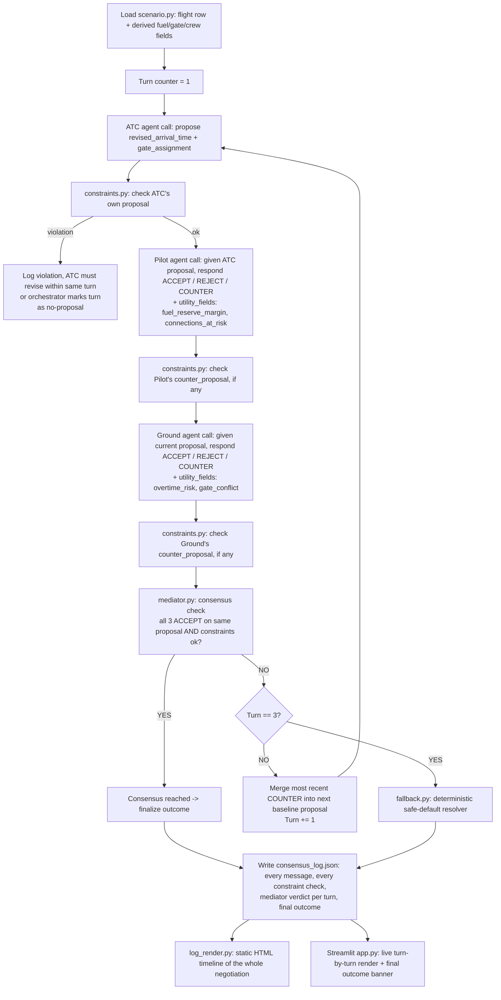

# Multi-Agent ATC Negotiation Framework — Build Spec

**Challenge #2:** "How might AI help air traffic controllers, pilots and ground operations staff make faster and better decisions?"
**Time budget:** ~5 hours. Every choice below is biased toward "ships and demos reliably" over "architecturally ideal."

## 1. Goal

Given one real disrupted-flight row from the 2015 DOT flights dataset, three independent LLM agents (ATC, Pilot, Ground) exchange structured messages and negotiate a revised **arrival time** and **gate assignment** within a hard turn cap. A deterministic (non-LLM) constraint validator vetoes any proposal that violates operational safety/ops limits. A deterministic mediator scores proposals and declares consensus. If no consensus is reached within 3 rounds, a deterministic rule-based fallback produces a safe default outcome. Everything is logged to a traceable JSON consensus log and rendered in a Streamlit app.

## 1a. End-to-end pipeline (the full sequence, one diagram)

This is the exact sequence `orchestrator.py` drives, start to finish, for the single baked-in scenario:



Per-turn detail (what actually happens inside one "turn" box above):

1. **Propose** — one agent (ATC on turn 1; otherwise whoever's COUNTER became the new baseline) emits a structured proposal: `{revised_arrival_time, gate_assignment}`.
2. **Validate** — `constraints.py` runs against that proposal immediately (wake separation, fuel reserve, crew overtime, gate conflict). This happens *before* the other two agents even see it being treated as acceptable — a constraint-failing proposal is logged as invalid and still passed to the other agents for their vote, but it can never be the one the mediator accepts.
3. **Respond** — the other two agents, one at a time (Pilot then Ground), each independently vote `ACCEPT | REJECT | COUNTER` on the current proposal, attaching their own numeric `utility_fields` and a `rationale`. A `COUNTER` carries a full replacement proposal.
4. **Validate again** — any `counter_proposal` from Pilot or Ground is itself run through `constraints.py` before it's eligible to become next turn's baseline.
5. **Score/decide** — `mediator.py` looks at the three votes for *this exact proposal*: consensus only if all three are `ACCEPT` on the same proposal object and that proposal passed validation. No partial credit, no averaging — it's a strict gate, not a fuzzy score (the optional descriptive score from §8 is narrative-only and never flips this decision).
6. **Advance or stop** — consensus → done, skip straight to logging. No consensus and turn < 3 → mechanically pick the latest valid `counter_proposal` as next turn's baseline and loop. No consensus and turn == 3 → stop negotiating, call `fallback.py`.
7. **Log** — every step above (not just the final outcome) is appended to the JSON consensus log as it happens, so the log is a full replay, not a summary.

## 2. Stack & repo layout

- **Language:** Python (already set up — `.venv`, `requirements.txt` has `anthropic`, `streamlit`, `pandas`, `python-dotenv`).
- **LLM:** Claude Haiku 4.5 via the Anthropic SDK, one independent `messages.create` call per agent per turn. API key already present in `.env` as `ANTHROPIC_API_KEY` (confirm exact var name when wiring the client).
- **UI:** Streamlit (`app.py` already stubbed — replace its contents). This supersedes an earlier CLI-only plan: since the environment is already provisioned for Streamlit, build the live demo there instead of a terminal script.
- **Data:** Already present locally at `data/flights.csv` (DOT 2015 flights, 5.8M rows), `data/airlines.csv`, `data/airports.csv`. No download needed.

Flat script layout, no package/src nesting:

```
app.py              # Streamlit entry point — UI only, imports orchestrator
scenario.py         # loads/derives the fixed demo row + simulated extra fields
agents.py           # 3 agent personas: build_prompt(role, state) + call_agent(role, state)
constraints.py      # deterministic validator: check(proposal) -> (ok: bool, violations: list[str])
mediator.py         # deterministic scorer: score(proposal, agent_votes) -> consensus: bool, score breakdown
fallback.py         # deterministic rule-based safe-default resolver
orchestrator.py      # the turn loop: ATC -> Pilot -> Ground each round, up to 3 rounds, builds the consensus log
log_render.py        # turns the JSON consensus log into the static HTML visualization
.plans/atc-multiagent-negotiation-spec.md   # this file
```

## 3. Scenario (baked-in, not random)

Hardcode this row from `data/flights.csv` as the one and only demo scenario (deterministic, reproducible, no risk of a bad row at demo time):

| Field | Value |
|---|---|
| Airline | AA |
| Flight number | 1057 |
| Origin | DFW |
| Destination | MIA |
| Date | 2015-01-01 |
| Scheduled departure | 05:15 |
| Scheduled arrival | 08:56 |
| Departure delay | 108 min |
| Arrival delay | 102 min |
| Weather delay | 102 min |
| Cancelled / Diverted | No / No |

The dataset has no fuel, gate, crew, or passenger-connection fields — these are not in scope for random simulation. Derive them **deterministically** from the row (e.g. a seeded hash of flight number + date, or a fixed formula) so every run produces the same numbers. In `scenario.py`, derive and hardcode comments explaining each:

- `fuel_reserve_minutes` — e.g. derived as a function of scheduled flight time and delay (must be plausible: enough to be interesting but not already in violation at scenario start).
- `current_gate` / `requested_gate` at MIA — pick two distinct plausible gate IDs.
- `connecting_passengers` — a count, used by the Pilot agent's "protect connections" objective.
- `ground_crew_shift_end_minutes` — how long until the assigned ground crew's shift ends, used by the Ground agent's "avoid overtime" objective.

Keep these as named constants/derivations in `scenario.py`, not magic numbers scattered in `agents.py`.

## 4. Agent roles (3 independent LLM calls — never combined into one prompt)

Each agent is called separately with only the structured messages addressed to it (no shared memory object visible to all three — this directly satisfies the brief's "don't combine 3 roles into a single prompt call" requirement).

- **ATC agent** — objectives: runway wake separation, taxiway blockage avoidance, maximize sector throughput. Proposes/responds on: revised arrival time slot.
- **Pilot agent** — objectives: preserve fuel reserves, flight safety, minimize turbulence, protect passenger connections. Proposes/responds on: whether a given arrival time/gate works given fuel reserve and connections.
- **Ground agent** — objectives: gate utilization, avoid ground-crew overtime, minimize turnaround delay. Proposes/responds on: gate assignment.

**Negotiable fields** (scope locked for the 5-hour build): `revised_arrival_time`, `gate_assignment`. Flight-plan/routing adjustment is explicitly out of scope (stretch-only, skip unless everything else is done early).

Each agent call returns a structured JSON object (not free text) — see §6 for schema. Use Claude's tool-use / structured-output support (or a strict "respond with only this JSON shape" instruction + a parse/retry) to keep this deterministic and parseable.

## 5. Turn structure

- 1 "turn" = each of the 3 agents makes exactly one structured proposal/response, in fixed order **ATC → Pilot → Ground**.
- Hard cap: **3 turns**. If no consensus by the end of turn 3, the fallback (§8) fires.
- Turn 1: ATC proposes an initial revised arrival time (based on the weather delay). Pilot and Ground each respond with ACCEPT/REJECT/COUNTER against that proposal, including their own structured objection fields (e.g. Pilot flags fuel reserve margin, Ground flags gate conflict).
- Turn 2+: the orchestrator folds the prior turn's counters into the next proposal (mechanically — pick the most recent COUNTER as the new proposal baseline) and repeats.

## 6. Structured message schema

Every agent call takes and returns JSON. Example shape (exact field names to finalize in code, but keep this structure):

```json
{
  "from": "pilot",
  "turn": 1,
  "proposal_under_review": {
    "revised_arrival_time": "10:45",
    "gate_assignment": "D12"
  },
  "vote": "COUNTER",          // ACCEPT | REJECT | COUNTER
  "counter_proposal": {
    "revised_arrival_time": "11:05",
    "gate_assignment": "D12"
  },
  "rationale": "Fuel reserve drops below safe margin at 10:45 given current holding pattern.",
  "utility_fields": {
    "fuel_reserve_margin_minutes": 12,
    "connections_at_risk": 3
  }
}
```

The `utility_fields` per agent feed the deterministic mediator's scoring (§7) — these are numeric, not prose, so scoring stays non-AI.

## 7. Constraint validator (deterministic, non-LLM) — `constraints.py`

Runs **after every proposal**, independent of the LLMs. A proposal that fails this can never be accepted, regardless of what the agents "agree" to. Simplified, clearly-labeled round-number thresholds (not claimed as FAA-accurate):

- **Wake separation:** minimum 3 minutes between the proposed arrival slot and the nearest other scheduled arrival (use a small fixed list of "other traffic" slots around the scenario time, hardcoded in `scenario.py`, to make this checkable).
- **Min fuel reserve:** proposal rejected if `fuel_reserve_margin_minutes < 30`.
- **Max ground crew overtime:** proposal rejected if the gate/turnaround plan pushes ground crew more than 30 minutes past `ground_crew_shift_end_minutes`.
- **Gate conflict:** rejected if the proposed gate is already occupied at the proposed arrival time (check against a small hardcoded gate-occupancy table in `scenario.py`).

Output: `(ok: bool, violations: list[str])`. A violation is logged every time, even if it's the reason a turn fails — this is the "explicit constraint checking" the brief asks for and must be visible in the consensus log, not hidden.

## 8. Mediator (deterministic, non-LLM) — `mediator.py`

Per the build decision: **no LLM call for the mediator.** After each turn's 3 agent responses + constraint check:

- Consensus reached **only if**: all 3 agents voted ACCEPT on the same proposal AND the constraint validator returned `ok=True`.
- If votes split or any COUNTER exists, no consensus — orchestrator proceeds to next turn using the mechanical counter-merge rule from §5.
- (Optional, time-permitting) compute a simple weighted score across `utility_fields` purely for the log/visualization narrative (e.g. "proposal scored 0.78 — fuel margin ok, overtime risk low") — but this score never overrides the ACCEPT/REJECT/constraint logic; it's descriptive, not a separate accept path, so there isn't a second "fuzzy consensus" mechanism to debug.

## 9. Deterministic fallback — `fallback.py`

Trigger: **3 turns elapsed with no consensus.** No other trigger condition (keep this single and simple to implement and explain).

Fallback logic (plain Python, no AI):
1. Take the last constraint-valid proposal seen across all 3 turns, if any existed but just lacked unanimous ACCEPT. Use it.
2. If no proposal was ever constraint-valid, fall back to a hardcoded safe default: assign the next known-free gate from the gate-occupancy table, and set arrival time = scheduled arrival + weather delay + a fixed 15-minute safety buffer.
3. Log clearly that the fallback fired and why (which turns failed and on what grounds).

## 10. Consensus log & output

A single run produces three artifacts:

1. **Console/Streamlit live trace** — turn-by-turn panel showing each agent's JSON message, the constraint check result, and whether consensus was reached, rendered as the negotiation unfolds (not just a final dump).
2. **JSON consensus log** (`consensus_log.json` or similar, written to disk per run) — full structured record: scenario input, every message from every agent every turn, every constraint check result, mediator decision each turn, final outcome (consensus or fallback), with the reasoning trail intact. This is the artifact that proves "traceable consensus log."
3. **Static HTML visualization** (`log_render.py`) — generated at the end of a run from the JSON log: a timeline of the 3 turns × 3 agents, color-coded ACCEPT/REJECT/COUNTER, constraint violations flagged, final outcome banner. This is the polished artifact to show judges after the live Streamlit run, or to leave open in a browser tab.

## 11. Streamlit app (`app.py`) — minimum UI

- Header: scenario summary card (flight AA1057 DFW→MIA, weather delay 102 min, etc.) pulled from `scenario.py`.
- A "Run negotiation" button that invokes `orchestrator.run()`.
- As it runs, render each turn's 3 agent messages (one expandable block per agent per turn) plus the constraint check result and mediator verdict for that turn.
- Final outcome banner: either "Consensus reached: revised arrival 11:05, gate D12" or "Fallback triggered: ..." with the reason.
- A link/button to open the generated static HTML visualization.
- No file upload, no scenario picker, no config sidebar — single fixed scenario, single button. Keep surface area minimal given the time budget.

## 12. Explicit non-goals (per the challenge's "what to avoid")

- No single combined prompt representing all 3 roles — always 3 separate Anthropic API calls.
- No unbounded negotiation loop — hard 3-turn cap enforced in `orchestrator.py`, loop cannot run longer regardless of agent output.
- No proposal can be accepted if it fails `constraints.py` — the validator is a hard veto, not a suggestion, and this is enforced in code (the orchestrator checks `ok` before ever considering a vote as consensus-eligible).
- Flight-plan/routing adjustment and taxiway/runway sequencing as separate negotiable fields: out of scope for this build (see §4).

## 13. Build order (suggested, to fit 5 hours)

1. `scenario.py` — hardcode row + derived fields + fake "other traffic"/gate tables. (~30 min)
2. `constraints.py` — pure functions, unit-testable without any LLM. (~30 min)
3. `agents.py` — 3 prompts + Anthropic call + JSON parsing/retry. Test each role in isolation first. (~90 min)
4. `mediator.py` + `fallback.py` — pure logic. (~30 min)
5. `orchestrator.py` — wire the turn loop, call constraint check after every proposal, write the JSON log. (~45 min)
6. `app.py` — Streamlit rendering of the live run. (~45 min)
7. `log_render.py` — static HTML from the JSON log. (~30 min)
8. Buffer for debugging/demo rehearsal. (~remaining time)

If time runs short, cut in this order: stretch flight-plan field (already out of scope) → HTML visualization (§10.3, fall back to showing the JSON log directly) → mediator's descriptive score (§8 optional part) → polish on Streamlit styling. Never cut: the 3-turn cap, the constraint validator veto, or the fallback path — these three are explicitly called out as judged requirements.
